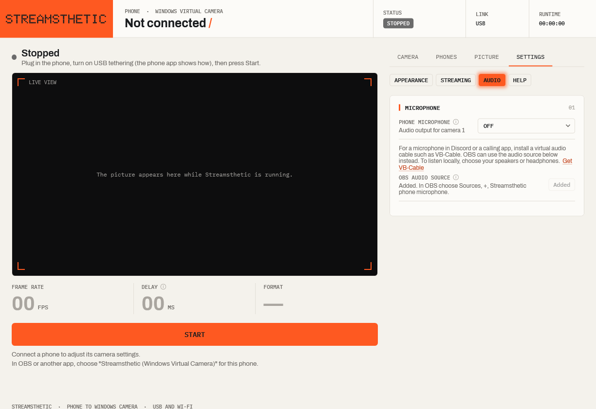

# Use the phone microphone

Microphone audio is optional. There are two ways to use it:

- **In OBS (30 or newer): no cable.** Add the **Streamsthetic phone microphone** source and pick the camera. Every camera has its own sound.
- **Anywhere else** (Discord, Teams, listening on the PC): Streamsthetic plays **camera 1's** sound on a Windows playback output. It does not install a Windows microphone, so calling apps need a virtual audio cable.

First, on the phone: **Settings > Streaming & power > Send the microphone to the PC**, then allow microphone access.

## Use the phone microphone in OBS

1. Make sure the source is installed: setup adds it when OBS is installed. If you installed OBS later, open Streamsthetic on the PC, **Settings > Audio > OBS audio source**, and choose **Add to OBS**. Restart OBS if it was open.
2. In OBS, under **Sources**, choose **+ → Streamsthetic phone microphone**.
3. Under **Phone**, pick the camera whose phone you want (Camera 1 is Streamsthetic, Camera 2 is Streamsthetic 2, and so on; the list matches your [number of cameras](multiple-phones.md#use-more-than-four-phones)).
4. Start streaming on that phone. The source's meter in the OBS **Audio Mixer** moves when you speak.

{ loading=lazy }

## Listen on the PC

1. In the Android app, open **Settings > Streaming & power** and enable **Send the microphone to the PC**. Allow microphone access when asked.
2. On the PC, open **Settings > Audio**.
3. Set **Phone microphone** to **Default speakers or headphones**, or select a named playback device.
4. Stop and restart the phone stream and its PC connection so both use the new audio settings.

Use headphones if the phone is near the PC to avoid feedback. Audio adds about 1 Mbps to the connection.

## Send audio to a calling app

The Windows camera device carries video. Selecting it in another app does not automatically select the phone as a microphone.

To make the phone audio available as a microphone input, install a separate virtual audio cable. Follow the provider's installation and restart instructions. With [VB-CABLE](https://vb-audio.com/Cable/), for example:

1. In Streamsthetic's **Settings > Audio > Phone microphone**, select **CABLE Input** (the cable's playback device).
2. Restart the PC camera connection.
3. In your calling app, select **CABLE Output** (the cable's recording device) as the audio input.
4. Check that the receiving app's audio meter responds when you speak.

The input/output naming is from the virtual cable: Streamsthetic plays into its input, and the receiving app records its output. Device names can vary. The cable is a separate installation; Streamsthetic does not bundle it. OBS does not need it: use the OBS source above.

## Turn audio off

Set **Phone microphone** to **Off** on the PC and restart the connection. To stop sending microphone audio from the phone too, disable **Send the microphone to the PC** in its settings and restart its stream.

If audio is silent, check microphone permission on the phone and that **Send the microphone to the PC** is on. In OBS, check that the source's **Phone** matches the camera the phone uses. For other apps, check that the phone is camera 1, the selected PC output and the receiving app's input. Restart the stream after changing audio settings.

Related: [Android app](android.md) · [Windows app](windows.md) · [Multiple phones](multiple-phones.md) · [Connect your phone](connect.md) · [Troubleshooting](troubleshooting.md)
