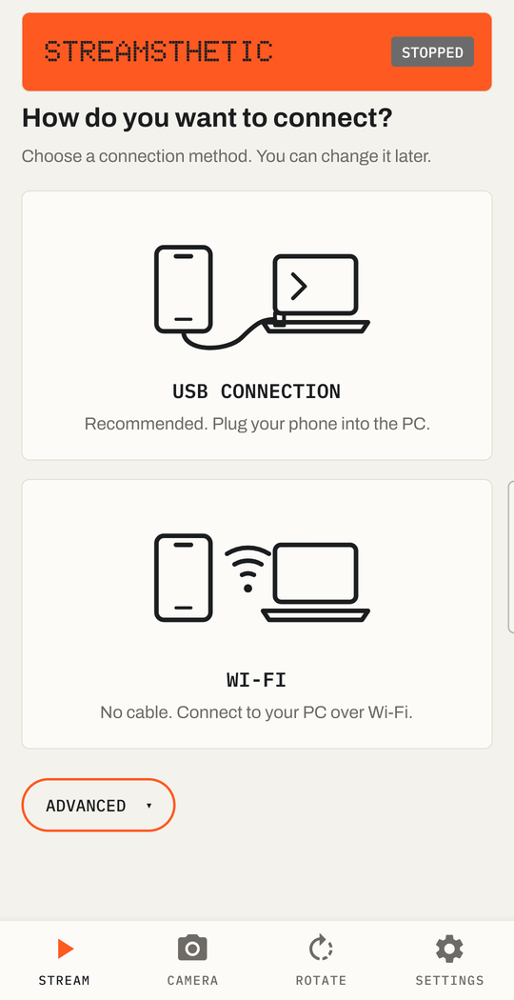
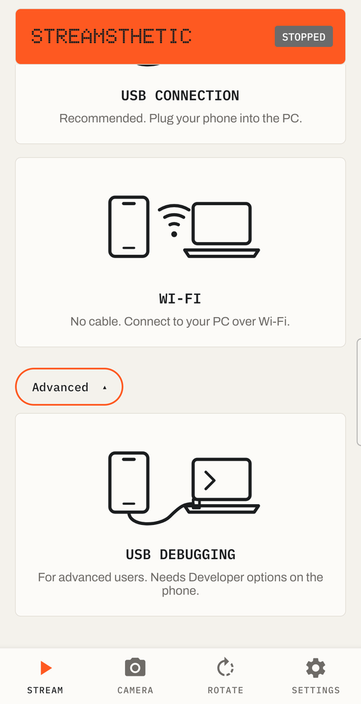
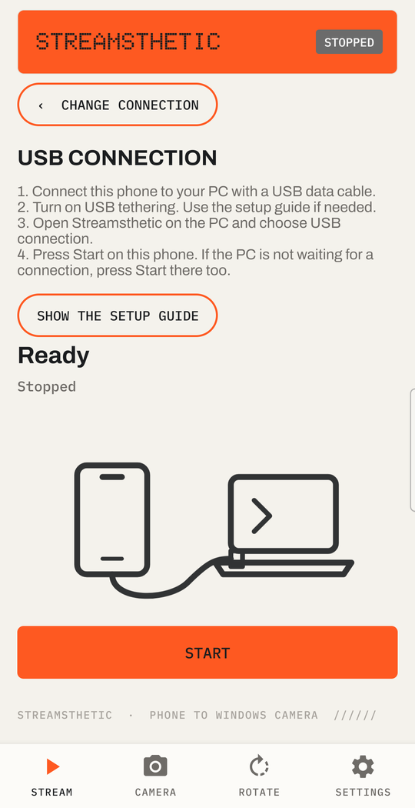
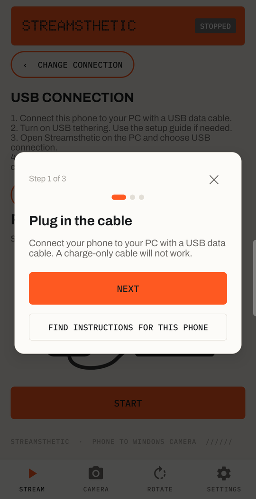
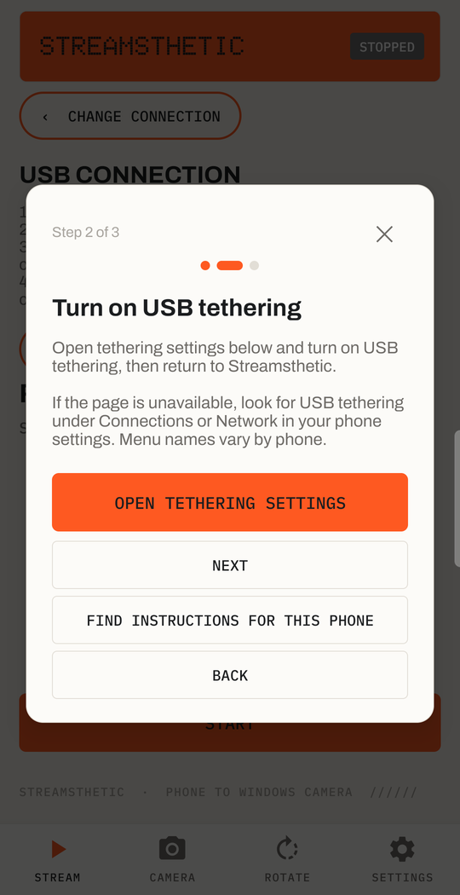
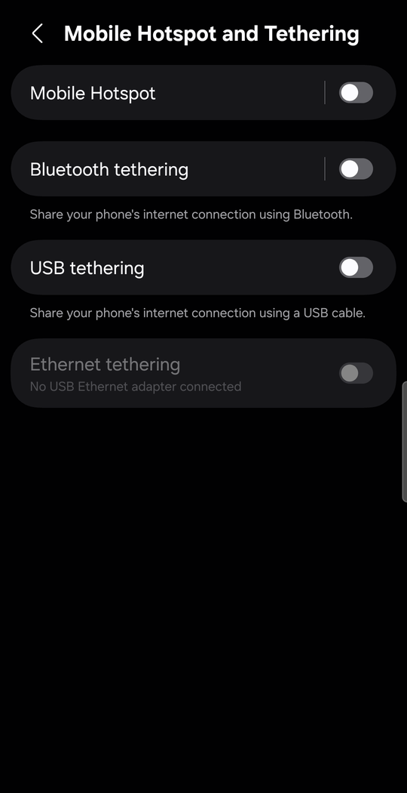
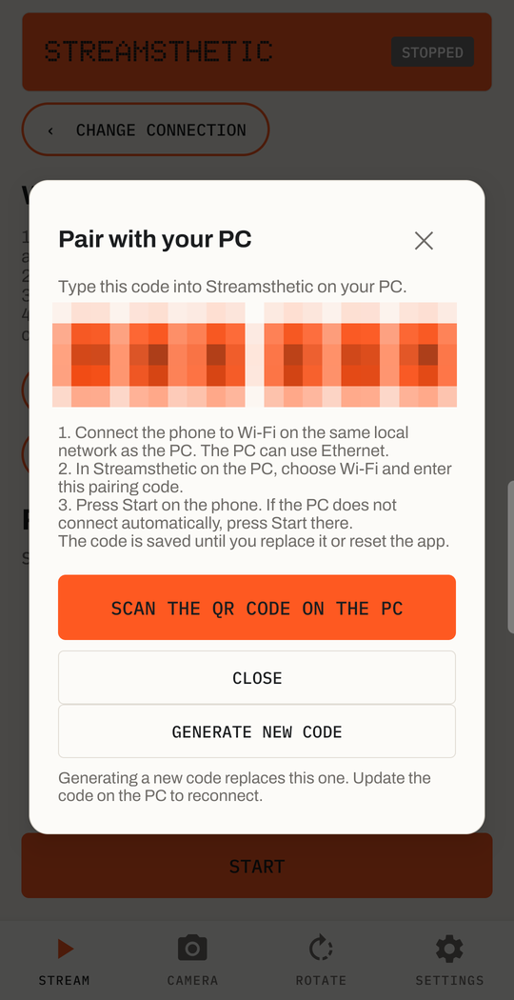

# Connect your phone

Install both apps first: [installation](install.md). This beta requires Windows 11 x64 and Android 11 or later. Streaming uses the cable or local network; it does not need internet access.

## Choose a connection

On the phone, the **Stream** tab asks how you want to connect. **USB connection** is recommended; **Wi-Fi** needs no cable; **USB debugging** is under **Advanced**.

{ width="270" loading=lazy } { width="270" loading=lazy }

## USB tethering

1. Connect the phone to the PC with a data-capable USB cable and unlock it.
2. In the phone app, choose **USB connection**, then **Show the setup guide**.
3. Follow **Open tethering settings** and enable USB tethering. The setting's location varies by phone.
4. In the PC app, choose **USB connection**.
5. Press **Start** on the phone. If the PC does not connect automatically, press **Start** there too.

{ width="270" loading=lazy } { width="270" loading=lazy } { width="270" loading=lazy }

**Open tethering settings** takes you to Android's own page. On Samsung phones it is **Mobile Hotspot and Tethering**; switch on **USB tethering**:

{ width="270" loading=lazy }

This route needs neither USB debugging nor a pairing code. If tethering is unavailable, use Wi-Fi or the debugging alternative below.

## Wi-Fi with a QR code

1. Connect the phone and PC to the same local network. The PC can use Ethernet.
2. Choose **Wi-Fi** in both apps. The PC displays a pairing QR code.
3. On the phone, tap **Scan QR code from the PC** and scan it.
4. Press **Start** on the phone. If the PC is not already waiting, press **Start** on the PC.

{ width="270" loading=lazy }

Pairing is saved. QR scanning uses Google Play services and may need an initial component download. Use manual pairing if scanning is unavailable.

## Wi-Fi with a pairing code

1. Choose **Wi-Fi** in both apps on the same local network.
2. On the phone, tap **Show pairing code (if you cannot scan)**.
3. Enter those six digits in the PC's **Pairing code** field, then choose **Use this code** or press Enter.
4. Press **Start** on the phone, then **Start** on the PC if it has not connected.

Keep the code private. **Generate new code** on the phone changes the code that PC connections must use. Forgetting a phone on the PC does not revoke its pairing code.

## USB debugging alternative

1. In the phone app's connection chooser, expand **Advanced** and choose **USB debugging**.
2. Tap **Show the setup guide**. Follow its steps to enable Developer options and USB debugging.
3. Connect a data cable, unlock the phone and approve **Allow USB debugging** for a PC you trust.
4. In the PC app, expand **Advanced**, select **USB debugging (advanced)** and press **Start**.

The Windows package includes the USB helper. You do not need to install an Android SDK. If authorization is stuck, use **Retry USB authorization** when the PC offers it, then check the phone for the prompt.

## Stop or connect another phone

1. Press **Stop** on the phone or PC to stop that connection.
2. Use **Phones → Stop all cameras** on the PC to stop every connection.

Closing the PC window can leave streams running when its tray option is enabled. See [Windows settings](windows.md), [Android settings](android.md), [multiple phones](multiple-phones.md), [camera controls](camera-controls.md) and [troubleshooting](troubleshooting.md).
