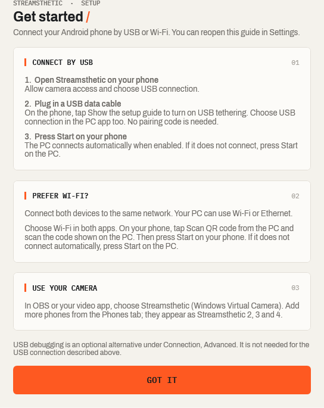
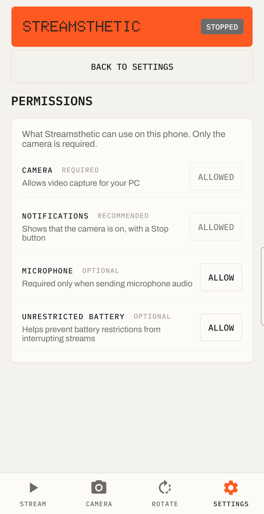

# Install Streamsthetic

Install the Windows app on your PC and the Android app on your phone. You need both to use the phone as a Windows camera.

## Before you start

| Device | Requirement |
| --- | --- |
| PC | Windows 11 on an Intel or AMD x64 processor. Windows 10 and Windows on ARM are not supported. |
| Phone | Android 11 or later, with a working camera. Available camera features depend on the phone. |
| Connection | A USB data cable with USB tethering, or a shared local network. The PC can use Ethernet. |
| Installation | Administrator approval for the Windows camera component. Permission to install the APK on Android. |

Windows needs its media components. On a Windows 11 N installation, add the **Media Feature Pack** if setup reports that these components are missing, then restart Windows and run setup again.

iPhone and macOS versions are not included in this release.

## Choose your downloads

Open the [v0.2.6-beta.1 release](https://github.com/cyclessomething/streamsthetic/releases/tag/v0.2.6-beta.1) and download these two files:

| File | Install it on |
| --- | --- |
| **Streamsthetic-Setup-offline.exe** | Windows. Recommended: includes the app runtime and USB tools. |
| **Streamsthetic-phone.apk** | Android. |

The offline Windows installer does not require Visual Studio, an Android SDK or a separately installed .NET runtime. The smaller **Streamsthetic-Setup.exe** needs .NET 10 Desktop Runtime and may download it during setup. The ZIP files are alternative packages; most people should use the offline EXE.

!!! note "Testing release"
    The Windows installer is unsigned, so Windows may show **Windows protected your PC**: choose **More info**, then **Run anyway**, for a download you trust. The Android app is signed with the Streamsthetic release key. See [testing coverage](https://github.com/cyclessomething/streamsthetic/blob/main/docs/TESTING.md) for the checks and remaining limits.

!!! warning "Coming from 0.2.5 or earlier on Android?"
    Earlier test versions used a temporary signing key, so Android will not install 0.2.6 over them. Uninstall Streamsthetic from the phone once, install the new APK, then pair again. Later updates install over it normally.

## Install on Windows

1. Open **Streamsthetic-Setup-offline.exe**.
2. Approve the administrator prompt for the camera component.
3. Let setup finish. If it reports a problem, follow the message before trying to stream.
4. Open **Streamsthetic** from the desktop or Start menu if it does not open automatically. The first time, a short setup guide opens:

{ loading=lazy }

The app installs for your Windows account and adds four camera outputs. You do not need to connect four phones to use it. If OBS Studio 30 or newer is installed, setup also adds the **Streamsthetic phone microphone** audio source to OBS (see [Microphone audio](audio.md)).

If camera setup was canceled, run the installer again and approve that prompt. Reopen any video app that was already running so it can refresh its camera list.

## Install on Android

1. Download **Streamsthetic-phone.apk** on the phone, or transfer it there from your PC.
2. Open the APK. If Android asks, allow your browser or file manager to install this app, then continue the installation.
3. Open **Streamsthetic** and allow camera access.
4. Allow notifications if you want streaming status and a stop control in the notification area.

Microphone access is needed only when you enable microphone audio. Unrestricted battery use is optional. You can review these choices in **Settings → Permissions**.

{ width="270" loading=lazy }

## Make your first connection

Follow [Connect your phone](connect.md). Start with one phone at **1080p, 30 fps**. Once the preview works, [select the camera in OBS or another video app](obs-and-video-apps.md).

**Related:** [Troubleshooting](troubleshooting.md) · [Update or uninstall](updates-and-removal.md)
