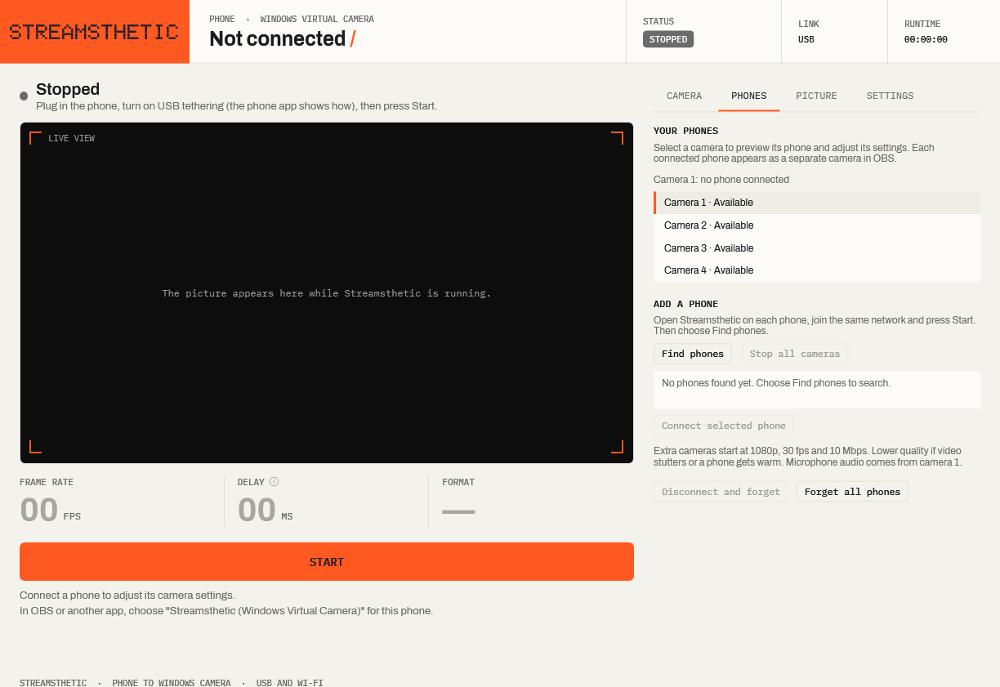
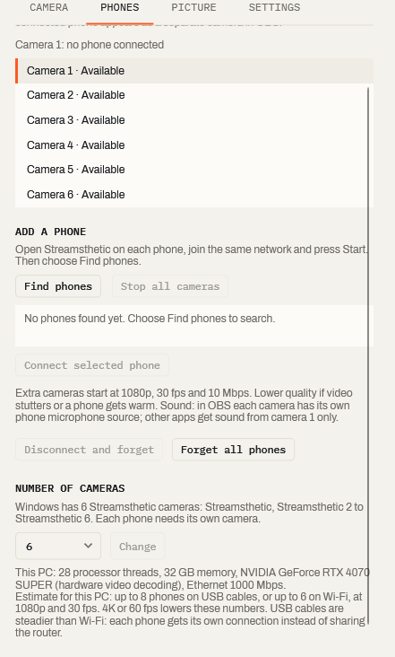

# Use multiple phones

Each phone appears as its own Windows camera, so you can add different angles in OBS or another app. Windows gets **4 Streamsthetic cameras** to start with; you can change that to any number from **1 to 16** (see [Use more than four phones](#use-more-than-four-phones)).

## Add phones over Wi-Fi

1. Connect the PC and phones to the same local network. The PC can use Ethernet.
2. In the PC's **Camera** tab, choose **Wi-Fi**. Pair each phone with the same PC QR code, so all phones use the same six-digit pairing code. See [Connect your phone](connect.md).
3. Press **Start** in Streamsthetic on each phone.
4. Open **Phones** on the PC and choose **Find phones**.
5. Select a phone in the results and choose **Connect selected phone**. Repeat for the other phones.

{ loading=lazy }

New phones fill available camera slots automatically. Selecting a camera row chooses which phone to preview and control; it does not move a phone into that slot. Assignments are remembered for later connections.

| Slot | Windows camera name |
| --- | --- |
| Camera 1 | Streamsthetic |
| Camera 2 | Streamsthetic 2 |
| Camera 3 | Streamsthetic 3 |
| Camera 4 | Streamsthetic 4 |
| Camera 5 and up | Streamsthetic 5, Streamsthetic 6, … (after you add more cameras) |

Windows or your receiving app may append **(Windows Virtual Camera)** to these names. Choose the corresponding device for each video source. If numbered cameras are missing, install the current Streamsthetic camera component.

## Adjust one phone

Select its row under **Your phones**. The preview and **Camera** and **Picture** controls now follow that phone. Changing the selected row leaves the other cameras running.

Extra cameras start at 1080p, 30 fps and 10 Mbps. Increase settings only if the phones, network and PC can keep up. Reduce resolution, frame rate or bitrate if video stutters or a phone gets warm. In OBS each phone's sound has its own **Streamsthetic phone microphone** source; for other apps, microphone audio comes from camera 1 only.

## Stop or remove a phone

| Action | Result |
| --- | --- |
| Select a camera, then press **Stop** | Stops that PC connection and keeps its assignment. Press **Start** to resume it. |
| **Stop all cameras** | Stops all PC camera connections and keeps their assignments. |
| Select a camera, then **Disconnect and forget** | Stops that connection and frees its slot. |
| **Forget all phones** | Stops connections and removes remembered phone assignments from this PC. |

Stopping on the PC does not revoke pairing or necessarily stop the phone app. Use **Stop** on the phone when you are finished to reduce battery use.

Forgetting removes a saved entry; it does not revoke pairing. To replace the old shared code, stop the streams first. Generate a new code on a phone you want to keep, enter it on the PC and choose **Use this code**. Scan the updated PC QR code on the other phones you want to keep, then reconnect them. Changing a code alone does not disconnect an active stream.

If automatic connection is enabled, remembered phones can reconnect when they start streaming. A camera you manually stop on the PC stays stopped until you start it again.

## Use more than four phones

1. On the PC, open **Phones** and scroll to **Number of cameras**.
2. Read the estimate for your PC: Streamsthetic looks at the processor, memory, graphics card and network, and suggests how many phones it can take **on USB cables** and **on Wi-Fi** at 1080p and 30 fps.
3. Pick a number and choose **Change**. A summary explains what changes. If the number is above the estimate, it warns you first.
4. Approve the Windows administrator prompt. Reopen video apps so they see the new cameras.

{ loading=lazy }

!!! info "What a higher number means"
    - Every app's camera list gets the extra cameras (Streamsthetic 5, Streamsthetic 6, …).
    - Each phone you connect adds work for the PC and **10–20 Mbps** of network traffic at 1080p (up to 60 Mbps at 4K). Phones get warm while streaming.
    - Above the estimate, video may stutter. Lower the resolution, frame rate or bitrate of the extra cameras if it does.
    - Lowering the number removes the highest cameras. Phones on them are disconnected, and OBS sources that use them show nothing until you choose another camera.

!!! tip "USB cables handle more phones than Wi-Fi"
    On USB, each phone has its own cable connection. On Wi-Fi, every phone shares the same router airtime, so Wi-Fi runs out first. For four or more phones, connect as many as you can with USB data cables (a powered USB hub helps), and keep the PC on Ethernet if some phones use Wi-Fi.

The estimate is a starting point, not a promise: it cannot know your router, cables or how warm your phones get. If video stutters, use fewer phones or lower their quality.

Related: [Windows app](windows.md) · [Audio](audio.md) · [Camera controls](camera-controls.md) · [Troubleshooting](troubleshooting.md)
