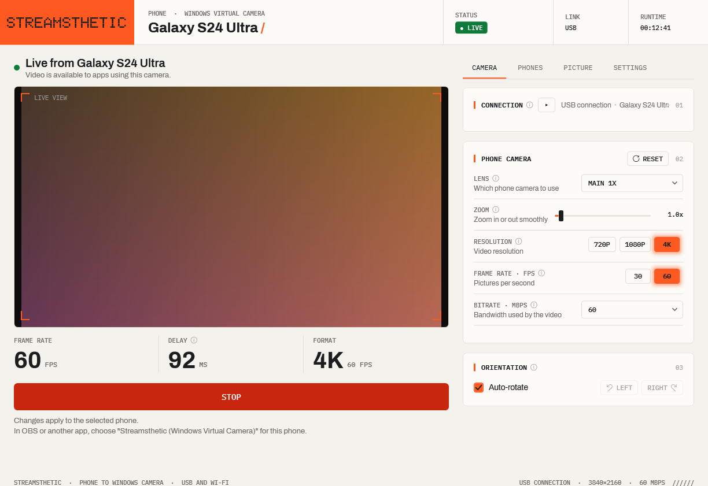
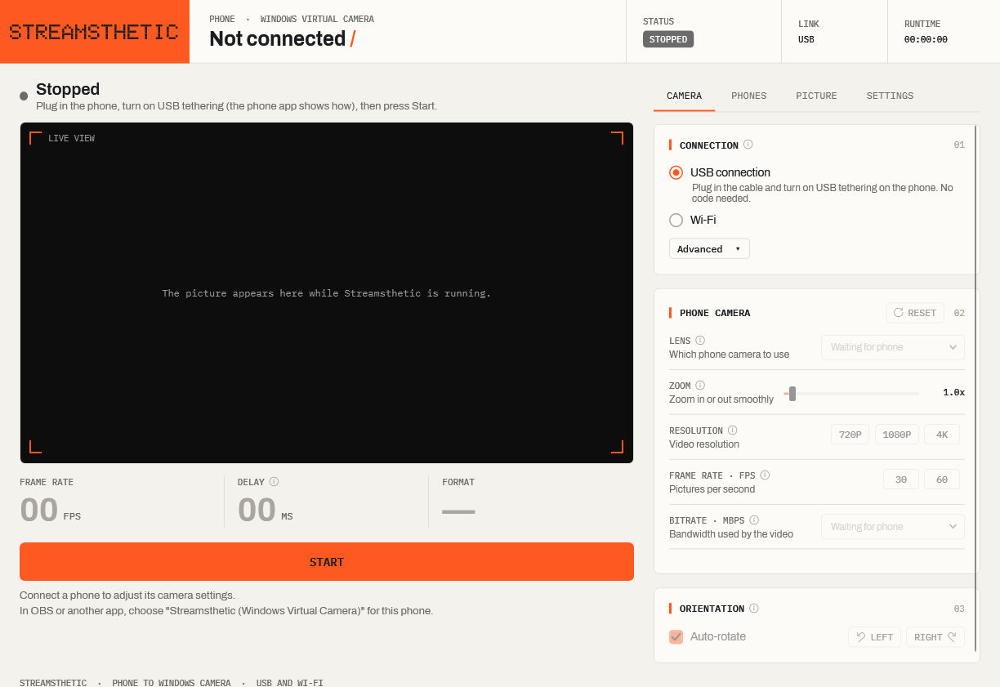
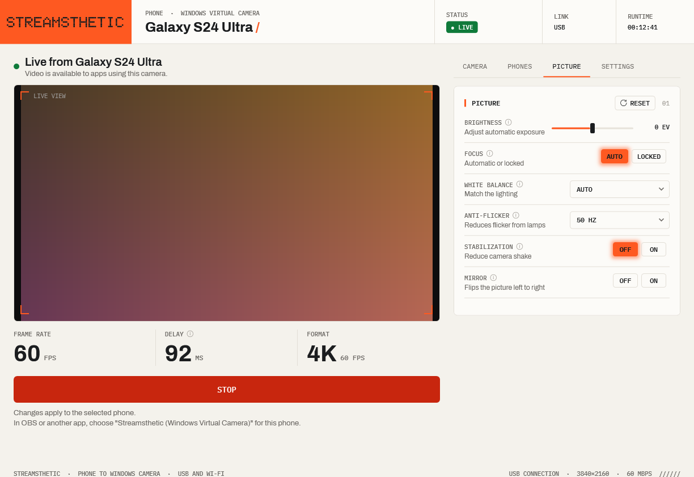
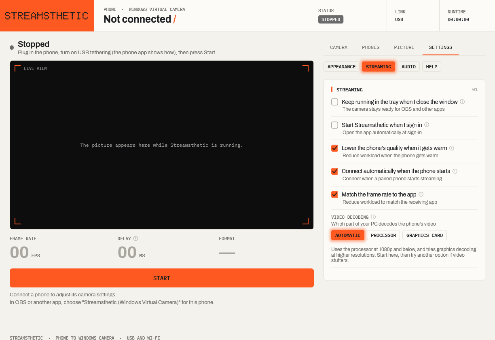
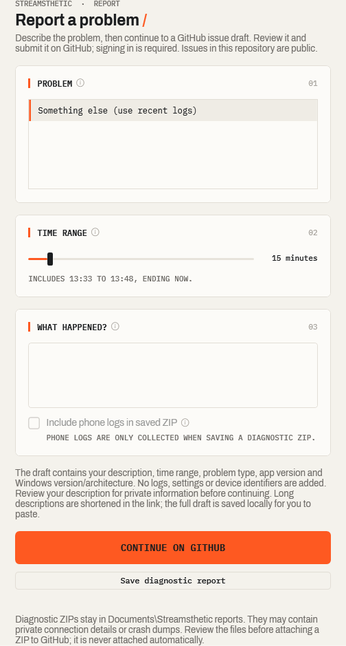

# Use Streamsthetic on Windows

Connect a phone, check its picture, then select the Streamsthetic camera in your calling or recording app. See [Connect your phone](connect.md) for the initial connection.

## Find the control you need

| Tab | Use it to |
| --- | --- |
| **Camera** | Choose the connection, lens, zoom, resolution, frame rate, bitrate and orientation. |
| **Phones** | Add phones, select the camera you want to control, disconnect a phone, or change the [number of cameras](multiple-phones.md#use-more-than-four-phones). |
| **Picture** | Adjust exposure, focus, white balance, flicker reduction, stabilization and mirroring. |
| **Settings** | Change the app's appearance, streaming behaviour, audio output and help options. |

Camera and Picture controls apply to the phone selected in **Phones**. Available camera options depend on the phone. See [Camera controls](camera-controls.md).

{ loading=lazy }

While no phone is connected, the settings that come from the phone say **Waiting for phone**:

{ loading=lazy }

## Start, stop and check the picture

1. Press **Start** on the phone and connect it on the PC.
2. Use the PC's **Start** and **Stop** control for the selected camera.
3. In your other app, choose **Streamsthetic (Windows Virtual Camera)**. Additional phones have numbered camera names.

{ loading=lazy }

The connection status explains whether the app is waiting, connecting or streaming. **Link** identifies the connection; **Format**, **Frame rate** and **Delay** help you check the stream. Follow any message shown below the controls if the connection needs attention.

The PC preview may pause when another app uses the camera to reduce processing work. The camera continues streaming. Choose **Show preview anyway** for a quick check, then **Pause the preview** if you no longer need both views. Minimizing or hiding the window also pauses its preview.

## Change app settings

Open **Settings**, then choose one category. Switching categories keeps your settings.

{ loading=lazy }

| Category | Options |
| --- | --- |
| **Appearance** | **Theme**, **Light or dark** (System follows Windows), and **Text and icon size**. Gamer always uses dark colours. These settings do not change the video. |
| **Streaming** | Tray behaviour, start at Windows sign-in, automatic connection, heat protection, matching the receiving app's frame rate, and video decoding. |
| **Audio** | **Phone microphone** output for camera 1, and **OBS audio source** (adds the phone microphone to OBS). See [Audio](audio.md). |
| **Help** | **Report a problem**, **Setup guide**, **Check for updates** (asks GitHub whether a newer version exists), and requirements. Updates do not install automatically. |

### Connect automatically

Enable **Connect automatically when the phone starts** for USB tethering or paired Wi-Fi phones. The phone must be ready and streaming. Stopping a camera on the PC keeps it stopped until you press **Start** again.

**Start when plugged in** is a separate option under **Camera > Advanced > USB debugging (advanced)**. It requires an authorized USB debugging connection and an unlocked phone; ordinary USB tethering does not require USB debugging.

### Keep streaming with the window closed

Enable **Keep running in the tray when I close the window** in **Settings > Streaming**. Closing the window then leaves active cameras running. Click the tray icon to reopen it, or right-click it and choose **Exit** to stop the app. Opening Streamsthetic from the Start menu while it is already running also brings the existing window back; only one copy runs at a time.

**Start Streamsthetic when I sign in** launches the app at Windows sign-in. If tray behaviour is also enabled, it starts in the tray. It still needs a ready phone and the appropriate connection settings.

### Choose a decoder

Under **Settings > Streaming > Video decoding**, choose **Automatic**, **Processor** or **Graphics card**. Start with Automatic. If a connection performs poorly, try another choice and restart that connection to apply it. The best choice depends on your PC and video format.

The same category lets you reduce the phone's workload when it gets warm and **Match the frame rate to the app**. Changing the phone's video format can briefly interrupt the picture.

## Get help

{ loading=lazy }

Use **Settings > Help > Report a problem**, describe the issue, then choose **Continue on GitHub**. Sign in if needed, review the public draft and submit it yourself. Streamsthetic does not submit an issue automatically. The draft adds the app and Windows versions, architecture, selected problem type and time range; it does not attach logs or settings.

**Save diagnostic report** separately saves a ZIP in **Documents\Streamsthetic reports**. Review it before sharing: it may contain private connection details or crash dumps. Long GitHub descriptions are shortened in the browser link, with the full draft saved locally at the location shown in the dialog. See [Privacy and diagnostic reports](privacy.md) or [Troubleshooting](troubleshooting.md).

Related: [Android app](android.md) · [Multiple phones](multiple-phones.md) · [Audio](audio.md)
