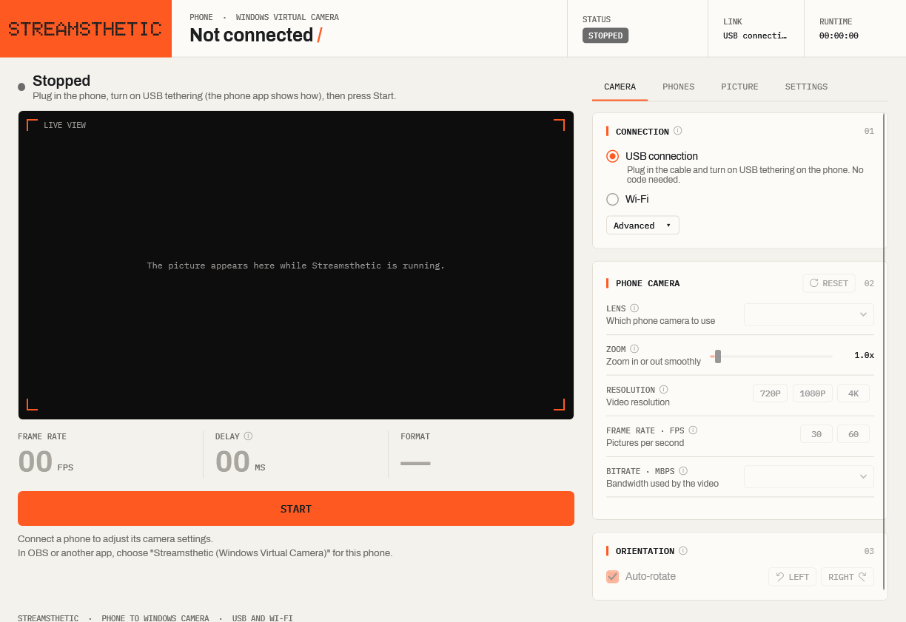

# Windows Sandbox test — 12 November 2026

**Result: partial runtime evidence; camera installation failed.** This run does not establish that Streamsthetic installs and streams successfully on a fresh Windows PC.

## Environment and package

- Fresh Windows Sandbox, Windows 11 build **26100.9974**, native x64.
- No .NET SDK, .NET Core runtime or Desktop Runtime found in the standard x64 installation directories; `dotnet.exe` was absent from PATH.
- Required Media Foundation DLLs were present.
- Network, clipboard, microphone, video-input and printer redirection were disabled. Only the dedicated test input and evidence folders were mapped.
- Tested the published **v0.2.4-beta.1** offline installer, app version **0.2.4**.
- Installer SHA-256: `F7CEE82B20046F6999C4C31FF1BA484BF7F4F8EE7149BB65832472A121111EF3`.

The initial run used the real installer with camera setup enabled and no test bypass switches.

## Observations

| Check | Result |
| --- | --- |
| No standard .NET SDK/Core/Desktop installation | Confirmed by the guest baseline inventory and PATH check. |
| Offline installer | Failed with exit code 1 during virtual camera registration. The installer displayed the failure. |
| Follow-up camera registration | Returned `0x80070005` (access denied) from an elevated process. |
| Camera-access probe | Windows reported `DeniedBySystem`. Media Foundation startup and virtual-camera object creation succeeded. |
| Installed app identity | SHA-256 and product version matched the expected packaged app. |
| App interface | Rendered successfully in a separate follow-up using the files left by setup. The captured interface was visually reviewed. |
| Bundled USB tool | Printed its ADB version information in the guest. No phone was attached. |
| Camera enumeration and video frames | Not verified. |
| Physical phone, USB, Wi-Fi and microphone | Not tested in this guest. |
| Upgrade and complete removal | Not tested in this guest. |

The follow-up process objects did not retain their numeric exit codes in the diagnostic JSON. The interface and USB-tool observations are based on the actual rendered image and command output, not an assumed zero exit code.

## Camera-access investigation

The follow-up ran with administrator privileges. The relevant user and machine webcam consent values were `Allow`, but the Windows camera-access API reported **`DeniedBySystem`**.

A separate probe returned success from **MFStartup** and **MFCreateVirtualCamera**, including a non-null camera object. It released that object without starting or registering a camera. This distinguishes successful object creation from the failing receiver registration operation; it does not identify the exact failure inside registration or activation.

Microsoft documents camera privacy controls for the virtual-camera API. Sandbox documentation also warns that disabling video input can prevent camera applications from working. The probe confirms a system camera-access restriction in this guest, but does not prove that the Sandbox video-input setting caused the registration failure. Host camera sharing was not enabled. See [virtual-camera API permissions](https://learn.microsoft.com/en-us/windows/win32/api/mfvirtualcamera/nf-mfvirtualcamera-mfcreatevirtualcamera) and [Sandbox video-input configuration](https://learn.microsoft.com/en-us/windows/security/application-security/application-isolation/windows-sandbox/windows-sandbox-configure-using-wsb-file#video-input).

## What the image proves

The installed app files can render their interface with the bundled runtime in this clean guest. The image shows a stopped, disconnected app after camera installation failed; it is not evidence of video delivery.

## Remaining acceptance

Resolve the camera-access failure or reproduce the installation in a full Windows 11 VM or separate clean PC. Then verify camera enumeration and real frame delivery, followed by physical-phone connections, upgrade and full removal. Keep this release marked as a testing beta until those checks are complete.

[Testing coverage](../TESTING.md) · [User guide](../guide/README.md) · [Downloads](https://github.com/cyclessomething/streamsthetic/releases/tag/v0.2.4-beta.1)
